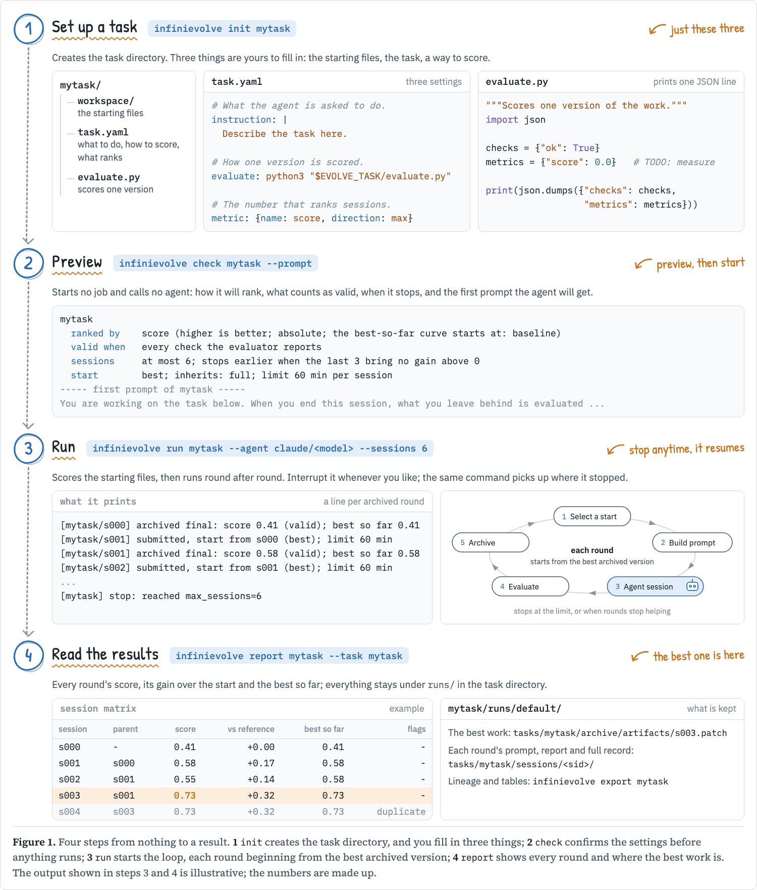
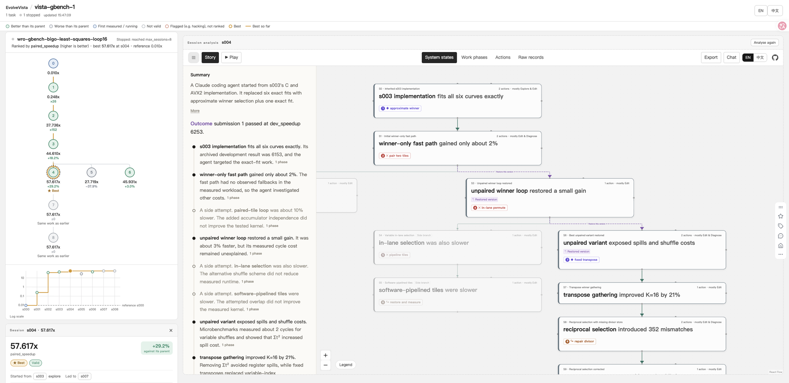

English | [简体中文](README.zh-CN.md)

# InfiniEvolve

An outer loop over coding-agent sessions. For each task it keeps a lineage: every session starts from
an earlier session's work, is told what the earlier ones tried, and is archived with everything it
produced. The loop decides where the next session starts and when the task has stopped improving.

The framework owns the loop and the archive. It does not know what a task is about: what is measured,
which way is better, what makes a result valid, what a session's work looks like and where an agent runs
all come from outside it.

<picture>
  <source media="(prefers-color-scheme: dark)" srcset="docs/images/workflow.dark.png">
  
</picture>

## Quick start

Needs Python 3.10 or newer, and `git`.

```sh
git clone https://github.com/InfiniEvolve/InfiniEvolve.git && cd InfiniEvolve
uv venv -p 3.11 .venv && uv pip install -p .venv -e .

.venv/bin/infinievolve run examples/golf
```

[`examples/golf`](examples/golf) is a task directory: it asks for a correct program that is as short as
possible, and a scripted stand-in plays the agent, so it runs in a few seconds without any account. It
ends with the summary:

```
| task | ranked by | sessions | valid | reference | best | vs reference | best session | agent h | status |
|---|---|---|---|---|---|---|---|---|---|
| golf | bytes | 8 | 8 | s000 466 | 163 | -303 | s005 | 0.00 | best 163 within 0.0 of 163 over the last 3 sessions |
```

## Parallel agents for one task

Set `campaign.agents_per_round` in a run's `config.yaml` to generate several
candidates per round (default **1**). `campaign.max_parallel` remains the global
job limit. Choose `strategy.selection: greedy`, `probabilistic`, or `genetic`.
The next round waits for all candidates and required repeat scoring. Genetic
mode maintains a population and asks each agent to combine selected parent
artifacts and optionally mutate the result, using the task's original evaluator.

See [configuration, selection semantics and restart behavior](docs/parallel-rounds.md).
Existing configurations retain their sequential behavior.

## What you get

Everything a run produces is in its own directory: `<task>/runs/<name>/` for a task directory, the
campaign directory otherwise. Relative to it:

| You want | Look at |
|---|---|
| how each task ended up | `summary.md` (also printed by `infinievolve report`) |
| one task session by session: every metric, the best so far, flags | `tasks/<task>/archive/matrix.md` (`infinievolve report --task <task>`) |
| the best work itself | `tasks/<task>/archive/artifacts/<best session>.patch`: a diff against the task's baseline, to apply with `git apply` in a copy of `workspace/` |
| what a session was told | `tasks/<task>/sessions/<sid>/input/prompt.md` and `archive.md` |
| what a session said it did and learned | `tasks/<task>/sessions/<sid>/derived/report.md` |
| what the agent actually did | `tasks/<task>/sessions/<sid>/raw/`, whatever the adapter keeps (the built-in one keeps the agent's output and the evaluator's result) |
| why a starting point was chosen | `tasks/<task>/sessions/<sid>/input/selection.json` |
| everything that happened, in order | `events.jsonl` |
| tables and lineage graphs for analysis | `exports/` after `infinievolve export`: `nodes.csv`, `scores.csv`, `best_so_far.csv`, `<task>/lineage.{json,dot,mmd}` |

Nothing is overwritten: every session keeps its inputs, its raw outputs and what was derived from them,
with a checksum of every file, so a result can be traced back and a different analysis can be run later.

## Using it on your own task

The four steps of the figure, to copy:

```sh
infinievolve init mytask                                      # then fill in workspace/, task.yaml, evaluate.py
infinievolve check mytask --agent claude/<model> --prompt     # what it would do; starts nothing
infinievolve run mytask --agent claude/<model> --sessions 6   # interrupt and rerun to resume
infinievolve report mytask --task mytask
```

What the figure leaves out:

- **The evaluator** can be any program. It is run in a clean copy of one version of the work and prints,
  as its last line, `{"checks": {...}, "metrics": {...}}`. A version counts only when every check is
  true, and the metric named in `task.yaml` must be among the metrics.
- **The agent** is one of:

  | `--agent` | Runs |
  |---|---|
  | `claude/<model>[:<effort>]` | Claude Code, without interaction |
  | `codex/<model>[:<effort>]` | Codex, without interaction |
  | `--agent-command "<shell command>"` instead | anything else: the command gets the prompt on its standard input and in the file `$EVOLVE_PROMPT`, and runs in the working copy |
- **Several runs** of one task sit side by side: `--name` starts another, with another agent or other
  settings. Without it the run is `default`.

**The agent is not confined.** The two named agents run with their permission checks bypassed: they edit
files and run commands without asking, as you, and nothing keeps them inside the working copy. Run where
you would let an agent do that.

When you need more:

| To | Do |
|---|---|
| record several metrics, gate on some checks only, score a new best again | write a `declaration` in `task.yaml` instead of `metric` ([What you declare](#what-you-declare)) |
| reword the task-specific sentences of the prompt | add `prompt:` to `task.yaml` |
| change the stop rule, what sessions inherit, or add rules for every session | edit `mytask/runs/<name>/config.yaml` |
| run several tasks side by side | write a campaign config: `infinievolve new campaigns/first` |
| run sessions on other machines, archive work that is not a set of file changes, read usage in your own way, check what an agent did | [write an adapter](docs/writing-an-adapter.md) |

## Watching a run

```sh
infinievolve run mytask --agent claude/<model> --watch     # serve the page while it runs
infinievolve watch mytask                                   # or from another terminal, or after it ended
```

The page is a plugin, [EvolveVista](https://github.com/InfiniEvolve/EvolveVista). Install it once:

```sh
infinievolve install-watch      # into the Python that runs infinievolve; run it again to update
```

<p align="center">
  
</p>
<p align="center"><sub>One task on the watch page: the lineage of its sessions, the best-so-far curve and the details of s004 on the left; s004's TraceVista analysis on the right.</sub></p>

Either command then prints an address on this machine, `http://127.0.0.1:8765/#live=...`; open it (or add
`--open`). The page shows each task's lineage, every session as a circle connected to the one it started
from, with the value it is ranked by and its change against that parent, and below it the best value after
each session; a campaign with several tasks shows them as tabs. Running sessions appear as soon as they are
submitted; click a circle for its measurements, flags, cost and report. Drag a session onto the analysis area
for its TraceVista analysis, written by an agent on this machine or a model you pick; `--analyst` and
`--no-agents` are passed to EvolveVista, whose README describes them.

InfiniEvolve's side is the snapshot, `infinievolve/snapshot.py`: the campaign as one JSON object, read from
the archive only, which the page receives each time the campaign changes. `--port` picks another port; a
taken one falls back to a free port.

## How it works

Each task keeps one lineage. The unmodified baseline is scored first and becomes its root, `s000`; after
that the loop of the figure repeats until `max_sessions` sessions have run, or the last `window_k` of
them did not beat the best value by more than `min_improvement`.

- **Where a session starts.** `best` takes the valid node with the best ranking value; `explore` draws
  among all valid nodes, more often the better ones and less often those many sessions already started
  from, so a weaker node can still become a stepping stone; `baseline` always starts from the unmodified
  baseline and uses the archive as context only.
- **What it is compared with.** Every result is read against a reference: the baseline when it is valid,
  and otherwise the first session that is. A task may start from nothing, and then the first working
  version is the yardstick for the later ones.
- **What runs when.** Sessions of one task run one after another, because each reads the archive of
  those before it. Different tasks run side by side, up to `max_parallel` jobs at once.
- **Interruptions.** A run can be stopped at any point; running it again re-attaches to jobs that are
  still going. A session that was prepared but never submitted (a crash, or a submit the adapter
  refused) keeps its id but is prepared again from the current instruction, prompt and archive.

## What you declare

An adapter gives a declaration for each task, and a campaign may override parts of it:

```yaml
metrics:                          # every number the evaluator reports
  pass_rate: {direction: max, scale: absolute, anchor: baseline, format: "{:.1%}"}
  tokens:    {direction: min, scale: absolute}
gate: [builds, tests_unchanged]   # the checks a version must pass to be valid (default: all it reports)
rank_by: pass_rate                # the one metric that picks starting points and feeds the stop rule
show: [pass_rate, tokens]         # what later sessions see
confirm: {samples: 2, aggregate: median}   # score a new best again before trusting it (optional)
flags: {suspicious_access: hard}  # levels of the flags the adapter raises
artifact: patch                   # the form a session's work is archived in
```

- **direction** says which way is better; **scale** says whether differences (`absolute`) or quotients
  (`ratio`) are what compare, which decides how selection weighs candidates and how `min_improvement`
  is read (an amount, or a percentage); **anchor** says where the best-so-far curve starts: the
  baseline's value by default, and the first valid session's when the baseline has none. **marks**
  (optional, e.g. `marks: {"known best": 0.92}`) are values drawn as lines on the watch page's curve;
  they never rank and may change during a lineage.
- The evaluator reports named **checks** for each version it scores. A version is valid when every check
  in `gate` is true; a check that was not reported counts as failed.
- Ranking uses a single metric. Others are recorded, shown and exported.
- The declaration in force when the baseline is archived is fixed for that lineage. To change it,
  reset the task. Two parts are exceptions. `confirm` follows `config.yaml` on the next `run` (recorded as a
  `confirm_changed` event), so repeat scorings can be turned down or off mid-campaign for their cost; a
  confirmation already requested still finishes with the scorings it was asked for. A metric's marks are
  only drawn, never ranked, so the lineage takes the configured ones.

## What is in the archive

```
<campaign>/
  config.yaml  provenance.json  state.json  summary.{json,md}
  events.jsonl                       every state change, with a timestamp and the task
  tasks/<task>/
    task.json                        the declaration this lineage is fixed to
    sessions/<sid>/
      input/     prompt.md archive.md start.* selection.json spec.json
      raw/       whatever the adapter keeps (transcripts, logs, evaluator output)
      derived/   scores.json report.md stats.json artifacts/
      job.json node.json manifest.json (sha256 of every file)
    archive/     nodes/ artifacts/ archive.jsonl matrix.{json,md}    the view the next agent reads
  exports/       <task>/lineage.{json,dot,mmd}  nodes.csv scores.csv best_so_far.csv
```

Every node has the same skeleton, whatever the task: its place in the lineage, its archived work
(`kind`, `fingerprint`, `summary`), every scored version with its checks and metrics, whether it is
valid, the value it is ranked by, the agent's report, timing, usage, and its flags.

**Flags** say that a node's result should not be taken at face value. Each has a level: `soft` is
recorded and shown; `hard` keeps the node from being a starting point, a best, or part of the stop
curve; `void` says no session happened. The adapter raises flags and declares their levels; a person can
add one with `infinievolve flag` and lift them with `infinievolve clear`. The framework raises two of its
own: `duplicate` (soft) when a session's work is identical to an earlier node's, for artifact kinds that
can tell, and `confirmation_failed` (hard) when a repeat scoring rejects work the first scoring accepted.

**Artifact kinds** describe the form of a session's work. The adapter produces the bytes and restores
them as a later session's starting point; the kind summarises them for the prompt, renders them for the
full archive, and gives a fingerprint when equal bytes mean equal work. `patch` (a diff against the
baseline) and `text` (one document) are included; `infinievolve.artifacts.register_artifact` adds
another.

## Commands

`<target>` is a task directory or a campaign directory. For a task directory, `--name` picks one of its
runs (`default` when left out).

```sh
infinievolve init mytask                    # a new task directory to fill in
infinievolve check <target> [--prompt]      # what a run would do, and its first prompt; starts nothing
infinievolve run <target> [--name N]        # can be interrupted and run again
infinievolve watch <target> [--open]        # the lineage and best value in the browser, live
        [--agent claude/<model> | --agent-command "..."] [--sessions N] [--start best|explore|baseline] [--watch]
                                            # ... the settings of a task directory's run, given at its first run
infinievolve status <target>
infinievolve report <target> [--task T]
infinievolve export <target>
infinievolve reset <target> --task T                               # start one task over
infinievolve flag  <target> --task T --session S --flag NAME --reason "..." [--level hard|soft|void]
infinievolve clear <target> --task T --session S --reason "..."
infinievolve new campaigns/first            # a commented campaign config.yaml to edit
```

A campaign is a directory whose `config.yaml` is its only configuration, and everything it produces
stays in that directory. A task directory's runs are campaigns too: `infinievolve run mytask` writes
`mytask/runs/default/config.yaml` the first time, and that file is the run's configuration from then on.

`infinievolve new` writes a config that lists every setting with a comment; `infinievolve check` reads a
config (or a task directory) and says what it amounts to before anything is spent. With the built-in
adapter, a campaign's task directories go in `<campaign>/task-defs/` (`options.tasks_dir`), never in its
`tasks/`: that is the archive, and `reset` deletes a task's directory there.

`run` stays in the foreground for as long as the campaign lasts and prints a line per archived session.
For a long campaign, start it where it survives your terminal (`nohup`, `tmux`) and send its output to a
file. If it is stopped, jobs already submitted keep going, and the next `run` picks them up.

`prompt.carry` sets what a session inherits from the ones before it, independently of what it starts
from: `full` (the table, every report, every session's work), `reports` (without the work) or `none`
(no archive, and the prompt does not mention one).

## Writing an adapter

An adapter is the only code that knows how your tasks run. The built-in one, `local`, runs every job as a
process on this machine; a task directory uses it without saying so. Write your own to run sessions
elsewhere or to evaluate differently. It implements `infinievolve.core.adapter.Adapter`:

| It says | With |
|---|---|
| what the tasks are | `resolve_tasks`, `instruction`, `default_time_limit_seconds` |
| what is recorded and ranked | `declaration` |
| the task-specific sentences of the prompt | `prompt_text` |
| how a job runs | `submit_baseline`, `submit_session`, `poll`, `collect` |
| whether the environment is broken | `baseline_problem` |
| how archived work is scored again, if it declares `confirm` | `submit_rescore` |

**[Writing an adapter](docs/writing-an-adapter.md)** is the full guide: what the framework hands an
adapter and expects back, method by method, the result `collect` returns field by field, how to report a
job that went wrong, and how to test an adapter before spending anything on an agent.
[`infinievolve/local.py`](infinievolve/local.py) is a complete adapter in one file to start from, and
[`examples/faibench`](examples/faibench) one whose jobs run on a cluster.

For tasks ranked by how fast something runs, [Tasks ranked by speed](docs/timing-tasks.md) describes the
layer between the framework and such adapters: paired timing, repeat scoring, and when a measurement is
not believed.

A campaign names its adapter as `local`, a registered name, an entry point of the group
`infinievolve.adapters`, `package.module:Name`, or `path/to/file.py:Name`.

## Tests

```sh
uv pip install -p .venv pytest && .venv/bin/python -m pytest -q
```

`tests/fake_adapter.py` stands in for an adapter without running anything; two tests run task
directories end to end with the built-in adapter and need `git`.

## License

[MIT](LICENSE)
