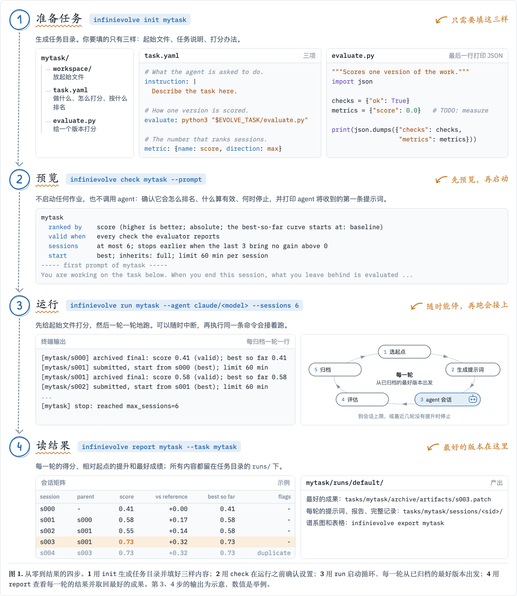

[English](README.md) | 简体中文

# InfiniEvolve

套在 coding agent 会话之外的一层循环。它为每个任务维护一条谱系：每次会话从某次早先会话的成果出发，
能读到之前各次会话试过什么，结束后连同产生的全部内容一起归档。下一次会话从哪里开始、任务何时
不再有进展，由这层循环决定。

框架只负责循环和档案，不了解任务本身：测量什么、哪个方向更好、怎样的结果算有效、一次会话的成果
是什么形式、agent 在哪里运行，都由框架之外提供。

<picture>
  <source media="(prefers-color-scheme: dark)" srcset="docs/images/workflow.zh-CN.dark.png">
  
</picture>

## 快速开始

需要 Python 3.10 或更高版本，以及 `git`。

```sh
git clone https://github.com/xiemeimeiaaa/InfiniEvolve.git && cd InfiniEvolve
uv venv -p 3.11 .venv && uv pip install -p .venv -e .

.venv/bin/infinievolve run examples/golf
```

[`examples/golf`](examples/golf) 是一个任务目录：它要求写出尽可能短的正确程序，agent 由一个脚本替身
扮演，所以几秒钟就能跑完，不需要任何账号。运行结束时打印汇总：

```
| task | ranked by | sessions | valid | reference | best | vs reference | best session | agent h | status |
|---|---|---|---|---|---|---|---|---|---|
| golf | bytes | 8 | 8 | s000 466 | 163 | -303 | s005 | 0.00 | best 163 within 0.0 of 163 over the last 3 sessions |
```

## 产出是什么

一次运行产生的所有内容都在它自己的目录里：任务目录是 `<task>/runs/<name>/`，否则就是 campaign 目录。
以下路径相对于该目录：

| 想知道 | 看哪里 |
|---|---|
| 每个任务最后的结果 | `summary.md`（`infinievolve report` 也会打印） |
| 某个任务逐次会话的情况：每个指标、当前最好成绩、标记 | `tasks/<task>/archive/matrix.md`（`infinievolve report --task <task>`） |
| 最好的成果本身 | `tasks/<task>/archive/artifacts/<最好的会话>.patch`：相对任务 baseline 的 diff，在 `workspace/` 的一份副本里用 `git apply` 应用 |
| 某次会话收到的提示词 | `tasks/<task>/sessions/<sid>/input/prompt.md` 和 `archive.md` |
| 某次会话自述做了什么、学到什么 | `tasks/<task>/sessions/<sid>/derived/report.md` |
| agent 实际做了什么 | `tasks/<task>/sessions/<sid>/raw/`，内容由适配器决定（内置适配器保留 agent 的输出和评估器的结果） |
| 为什么选了某个起点 | `tasks/<task>/sessions/<sid>/input/selection.json` |
| 按时间顺序发生的所有事 | `events.jsonl` |
| 供分析用的表格和谱系图 | 运行 `infinievolve export` 后的 `exports/`：`nodes.csv`、`scores.csv`、`best_so_far.csv`、`<task>/lineage.{json,dot,mmd}` |

任何内容都不会被覆盖：每次会话的输入、原始输出和由此导出的内容都保留，并记录每个文件的校验和，
因此任何结果都能追溯，以后也可以换一种方式重新分析。

## 用在自己的任务上

图里的四步，便于复制：

```sh
infinievolve init mytask                                      # 然后填好 workspace/、task.yaml、evaluate.py
infinievolve check mytask --agent claude/<model> --prompt     # 说明会做什么；不启动任何东西
infinievolve run mytask --agent claude/<model> --sessions 6   # 中断后再次执行即续跑
infinievolve report mytask --task mytask
```

图里没有讲到的：

- **打分程序**可以是任何程序。它在成果某个版本的一份干净副本里运行，最后一行输出
  `{"checks": {...}, "metrics": {...}}`。只有所有检查都为真，这个版本才算数；`task.yaml` 里指定的指标
  必须出现在 metrics 里。
- **agent** 有以下几种指定方式：

  | `--agent` | 运行的是 |
  |---|---|
  | `claude/<model>[:<effort>]` | Claude Code，无交互模式 |
  | `codex/<model>[:<effort>]` | Codex，无交互模式 |
  | 改用 `--agent-command "<shell 命令>"` | 其他任何 agent：命令从标准输入和文件 `$EVOLVE_PROMPT` 得到提示词，在工作副本里运行 |
- 同一个任务可以并排**多次运行**：用 `--name` 另开一次，换一个 agent 或换一套设置。不写时运行名为
  `default`。

**agent 不受限制。** 上面两个具名 agent 都以跳过权限检查的方式运行：它们会不经询问地修改文件和执行
命令，身份就是你本人，也没有任何机制把它们限制在工作副本之内。请在你允许 agent 这样做的地方运行。

需要更多功能时：

| 想要 | 做法 |
|---|---|
| 记录多个指标、只对部分检查设门槛、对新的最好成绩复测 | 在 `task.yaml` 里写 `declaration` 代替 `metric`（见[需要声明的内容](#需要声明的内容)） |
| 改写提示词中与任务相关的句子 | 在 `task.yaml` 里加 `prompt:` |
| 修改停止规则、会话继承的内容，或给每次会话加规则 | 编辑 `mytask/runs/<name>/config.yaml` |
| 同时跑多个任务 | 写一份 campaign 配置：`infinievolve new campaigns/first` |
| 在别的机器上跑会话、归档不是文件改动的成果、按自己的方式读取用量、检查 agent 做了什么 | [编写适配器](docs/writing-an-adapter.zh-CN.md) |

## 工作流程

每个任务维护一条谱系。先给未修改的 baseline 打分，作为根节点 `s000`；之后重复图中的循环，直到会话数
达到 `max_sessions`，或者最近 `window_k` 次会话没能把最好成绩再提升超过 `min_improvement`。

- **会话从哪里开始。** `best` 取排名值最好的有效节点；`explore` 在所有有效节点中抽取，成绩越好越容易
  被抽中，已经被很多会话用作起点的节点则更少被抽中，因此较弱的节点仍有机会成为通向更好结果的垫脚石；
  `baseline` 总是从未修改的 baseline 出发，档案只作为参考。
- **和什么比较。** 每个结果都对照一个参考节点来读：baseline 有效时就是它，否则是第一个有效的会话。
  任务可以从零开始，这时第一个能用的版本就是衡量后续版本的标尺。
- **执行顺序。** 同一个任务内的会话按顺序进行，因为后一次要读前面的档案。不同任务之间并行，同时在跑
  的作业数不超过 `max_parallel`。
- **中断。** 运行可以随时停止；再次运行时会接回仍在运行的作业，并重新提交已准备好但还没启动的会话。

## 需要声明的内容

适配器为每个任务给出一份声明，campaign 可以覆盖其中一部分：

```yaml
metrics:                          # 评估器报告的每一个数值
  pass_rate: {direction: max, scale: absolute, anchor: baseline, format: "{:.1%}"}
  tokens:    {direction: min, scale: absolute}
gate: [builds, tests_unchanged]   # 版本必须通过这些检查才算有效（默认：它报告的全部检查）
rank_by: pass_rate                # 用来选起点和判断停止的那一个指标
show: [pass_rate, tokens]         # 后续会话能看到哪些指标
confirm: {samples: 2, aggregate: median}   # 新的最好成绩先复测再采信（可选）
flags: {suspicious_access: hard}  # 适配器所打标记的级别
artifact: patch                   # 会话成果以什么形式归档
```

- **direction** 说明哪个方向更好。**scale** 说明可比较的是差值（`absolute`）还是比值（`ratio`），
  它决定选择起点时如何给候选加权，以及 `min_improvement` 按数量还是按百分比理解。**anchor** 说明
  最好成绩曲线从哪里起算：默认是 baseline 的值，baseline 没有值时是第一个有效会话的值。
- 评估器为它打分的每个版本报告一组具名**检查**。`gate` 中列出的检查全部为真，这个版本才有效；
  没有报告的检查按未通过处理。
- 排名只用一个指标，其余指标照常记录、展示和导出。
- baseline 归档时生效的声明对这条谱系固定不变。要更换声明，需要重置该任务。

## 档案里有什么

```
<campaign>/
  config.yaml  provenance.json  state.json  summary.{json,md}
  events.jsonl                       所有状态变化，带时间戳和任务名
  tasks/<task>/
    task.json                        这条谱系固定下来的声明
    sessions/<sid>/
      input/     prompt.md archive.md start.* selection.json spec.json
      raw/       适配器保留的原始内容（对话记录、日志、评估器输出）
      derived/   scores.json report.md stats.json artifacts/
      job.json node.json manifest.json（每个文件的 sha256）
    archive/     nodes/ artifacts/ archive.jsonl matrix.{json,md}    给下一个 agent 看的视图
  exports/       <task>/lineage.{json,dot,mmd}  nodes.csv scores.csv best_so_far.csv
```

不论什么任务，每个节点的骨架都相同：它在谱系中的位置、归档的成果（`kind`、`fingerprint`、
`summary`）、每个被打分的版本及其检查和指标、是否有效、排名所用的值、agent 的报告、耗时、用量，
以及它的标记。

**标记**表示某个节点的结果不能直接采信。每个标记有一个级别：`soft` 只记录和展示；`hard` 使节点
不能作为起点、不算最好成绩、不进入停止曲线；`void` 表示这次会话实际上没有发生。标记由适配器打出
并声明级别，人也可以用 `infinievolve flag` 添加、用 `infinievolve clear` 解除。框架自己只打两种：
会话成果与早先某个节点完全相同时的 `duplicate`（soft，仅限能够判断这一点的成果类型），以及复测
否定了首次打分所接受的成果时的 `confirmation_failed`（hard）。

**成果类型**描述会话成果的形式。成果的字节内容由适配器产生，也由适配器还原为后续会话的起点；
成果类型负责为提示词生成概括、为完整档案生成展示内容，并在"字节相同即成果相同"成立时给出指纹。
内置 `patch`（相对 baseline 的 diff）和 `text`（单个文档）两种，可以用
`infinievolve.artifacts.register_artifact` 注册新的类型。

## 命令

`<target>` 是一个任务目录或一个 campaign 目录。对任务目录，`--name` 指定它的哪一次运行（省略时为
`default`）。

```sh
infinievolve init mytask                    # 新建一个待填写的任务目录
infinievolve check <target> [--prompt]      # 说明一次运行会做什么，并给出第一条提示词；不启动任何东西
infinievolve run <target> [--name N]        # 可以中断后再次运行
        [--agent claude/<model> | --agent-command "..."] [--sessions N] [--start best|explore|baseline]
                                            # ……任务目录某次运行的设置，在它第一次运行时给出
infinievolve status <target>
infinievolve report <target> [--task T]
infinievolve export <target>
infinievolve reset <target> --task T                               # 让某个任务从头开始
infinievolve flag  <target> --task T --session S --flag NAME --reason "..." [--level hard|soft|void]
infinievolve clear <target> --task T --session S --reason "..."
infinievolve new campaigns/first            # 生成一份带注释的 campaign config.yaml，供编辑
```

一个 campaign 就是一个目录，目录里的 `config.yaml` 是它唯一的配置，运行产出也都留在这个目录里。
任务目录的每次运行也是一个 campaign：`infinievolve run mytask` 第一次运行时会写出
`mytask/runs/default/config.yaml`，此后这个文件就是该次运行的配置。

`infinievolve new` 写出的配置列出了每一项设置并附有注释；`infinievolve check` 读取一份配置（或一个任务
目录），在花费任何东西之前说明它实际意味着什么。

`run` 在 campaign 进行期间一直在前台运行，每归档一次会话打印一行。长时间的 campaign 请在不随终端退出
的地方启动（`nohup`、`tmux`），并把输出写到文件。它被停止后，已提交的作业仍会继续，下一次 `run` 会
接上它们。

`prompt.carry` 决定一次会话从之前的会话继承什么，与它从哪个节点出发无关：`full`（表格、每份报告、
每次会话的成果）、`reports`（不含成果）或 `none`（没有档案，提示词也不提档案）。

## 编写适配器

适配器是唯一了解你的任务如何运行的代码。内置的适配器 `local` 把每个作业都作为本机上的一个进程运行，
任务目录默认用的就是它。需要在别处运行会话或用别的方式评估时，再编写自己的适配器。它实现
`infinievolve.core.adapter.Adapter`：

| 它说明 | 通过 |
|---|---|
| 有哪些任务 | `resolve_tasks`、`instruction`、`default_time_limit_seconds` |
| 记录什么、按什么排名 | `declaration` |
| 提示词中与任务相关的句子 | `prompt_text` |
| 作业怎么运行 | `submit_baseline`、`submit_session`、`poll`、`collect` |
| 环境是否损坏 | `baseline_problem` |
| 声明了 `confirm` 时，怎样给已归档的成果重新打分 | `submit_rescore` |

完整指南见 **[编写适配器](docs/writing-an-adapter.zh-CN.md)**：框架交给适配器什么、期望拿回什么，
逐个方法说明；`collect` 的返回值逐字段说明；作业出错时怎么上报；以及怎样在调用 agent 之前
先把适配器测通。[`infinievolve/local.py`](infinievolve/local.py) 是一个写在单个文件里的完整适配器，可以
作为起点；[`examples/faibench`](examples/faibench) 是一个把作业放到集群上运行的适配器。

对于按运行速度排名的任务，[按速度排名的任务](docs/timing-tasks.zh-CN.md)介绍了框架和这类适配器之间的
那一层：配对计时、复测，以及什么情况下不采信一次测量。

campaign 通过以下任一方式指定适配器：`local`、已注册的名字、`infinievolve.adapters` 组的 entry point、
`package.module:Name`，或 `path/to/file.py:Name`。

## 测试

```sh
uv pip install -p .venv pytest && .venv/bin/python -m pytest -q
```

`tests/fake_adapter.py` 是一个不实际运行任何东西的适配器替身；有两个测试会用内置适配器端到端运行
任务目录，需要 `git`。

## 许可证

[MIT](LICENSE)
